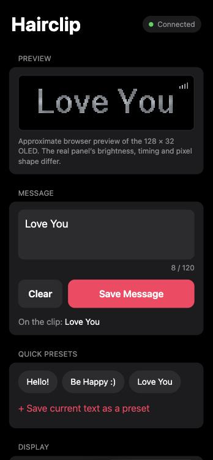
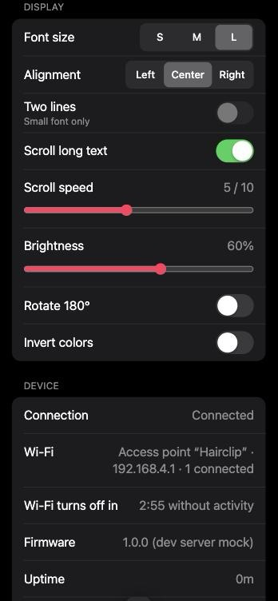
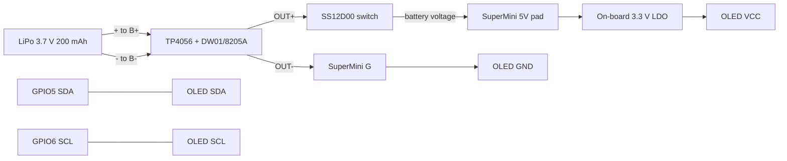

# ESP32-C3 OLED Hairclip

A wearable message display. An ESP32-C3 SuperMini Plus drives a 0.91″ 128×32
OLED on a hairclip, and you change the message from your phone over the clip's
own Wi-Fi: no app, no account, no internet.

> **Status: runs on a real ESP32-C3 with the OLED; the battery and charging
> are NOT HARDWARE TESTED.** On USB power, the display (all fonts, Romanian
> accents, two lines, scrolling, rotation, invert, brightness), the Wi-Fi
> page, saving from a phone, persistence, the BOOT button and the 3-minute
> auto-off all work.
> Read **[HARDWARE.md](HARDWARE.md)** before connecting a battery, and work
> through the **[hardware test checklist](docs/HARDWARE_TEST_CHECKLIST.md)**
> before wearing it.

<p>
  
  
</p>

*Screenshots of the real control page served by `tools/dev_server.py` against a
mock of the firmware's API (not from a device). The OLED preview is a
browser approximation.*

## Contents

1. [Features](#features)
2. [Hardware parts](#1-hardware-parts)
3. [Wiring](#2-wiring)
4. [Prerequisites](#3-prerequisites)
5. [Setup on Apple Silicon macOS](#4-setup-on-apple-silicon-macos)
6. [Build](#5-build)
7. [Flash](#6-flash)
8. [First boot](#7-first-boot)
9. [Join the Wi-Fi from iPhone or Android](#8-join-the-wi-fi-from-iphone-or-android)
10. [Open the control page](#9-open-the-control-page)
11. [Save a message](#10-save-a-message)
12. [Turn Wi-Fi on and off](#11-turn-wi-fi-on-and-off)
13. [Update the firmware](#12-update-the-firmware)
14. [Troubleshooting](#13-troubleshooting)
15. [Power and battery limitations](#14-power-and-battery-limitations)
16. [Supported characters](#supported-characters)
17. [Configuration](#configuration)
18. [HTTP API](#http-api)
19. [Development and testing status](#development-and-testing-status)
20. [License and credits](#license-and-credits)

## Features

* Shows the saved message at power-on (**Hello!** until you save one).
* Centered, left or right aligned text when it fits; smooth scrolling with
  adjustable speed when it does not.
* Three fonts (small, medium, large), all with Romanian diacritics
  (ă â î ș ț). The small font can show two lines.
* Brightness (SSD1306 contrast), 180° rotation and inverted colors.
* Wi-Fi access point **Hairclip** with a phone-friendly control page at
  **http://192.168.4.1**. It works completely offline; everything is served by
  the clip.
* The page includes a live preview drawn with the clip's own fonts, quick
  presets (Hello!, Be Happy :), Love You, plus up to 6 of your own), device
  status and a Wi-Fi off button.
* Wi-Fi switches itself off after 3 minutes without use. Hold **BOOT** for
  1.5 s to switch it on or off.
* Settings live in flash (NVS) and are written only when they change.
* The display animates in its own task, so it keeps moving while the web
  server works.
* Watchdogs restart the chip if the main loop or the display task ever hangs.
* A serial console over USB provides diagnostics and control: `status`,
  `msg <text>`, `set <field> <value>`, `wifi on`, `wifi off`, `restart`,
  `factory-reset`.

## 1. Hardware parts

| Part | Specification |
|---|---|
| Microcontroller | ESP32-C3 SuperMini Plus (native USB-C) |
| Display | 0.91″ SSD1306 OLED, 128×32, I²C address 0x3C |
| Battery | 402030 LiPo, 3.7 V nominal, 200 mAh, with built-in protection |
| Charger | TP4056 USB-C module with DW01/8205A protection; R_PROG changed from 1.2 kΩ to 10 kΩ (see [HARDWARE.md §3](HARDWARE.md#3-charger-programming-resistor)) |
| Switch | SS12D00 3-pin slide switch |
| Not fitted | external buttons, RTC, battery monitor, SD card, sensors |

The OLED is driven with U8g2's `SSD1306_128X32_UNIVISION` driver at 400 kHz.
Its controller setup (multiplex 1/32, COM pin config `0x02`, segment remap,
charge pump) matches the reference code for this 0.91″ module in
[winxos/stm32-hal-0.91oled-iic-ssd1306-demo](https://github.com/winxos/stm32-hal-0.91oled-iic-ssd1306-demo).
The firmware also probes 0x3D in case your module is strapped differently.

## 2. Wiring

| # | From | To | Note |
|---|---|---|---|
| 1 | Battery + (red) | TP4056 **B+** | Check polarity with a meter first |
| 2 | Battery − (black) | TP4056 **B−** | Never connect B− to OUT− |
| 3 | TP4056 **OUT+** | Switch middle (common) pin | |
| 4 | Switch outer pin | SuperMini **5V** | Receives battery voltage, not 5 V |
| 5 | TP4056 **OUT−** | SuperMini **G** | System ground |
| 6 | SuperMini **3V3** | OLED **VCC** | Match the label, not the position |
| 7 | SuperMini **G** | OLED **GND** | |
| 8 | SuperMini **GPIO5** | OLED **SDA** | |
| 9 | SuperMini **GPIO6** | OLED **SCL** | |

The BOOT button on the SuperMini is GPIO9 (active LOW). Leave the switch's
other outer pin unconnected.



> **Two USB-C ports, two jobs.** The **SuperMini's** port is for flashing and
> the serial console. The **TP4056's** port is only for charging. Never use
> both at once, and never plug in the SuperMini while the battery switch is ON
> ([why](HARDWARE.md#5-simultaneous-usb-and-battery)).

## 3. Prerequisites

* An Apple Silicon Mac (Intel Macs should also work) running a recent macOS
* [Homebrew](https://brew.sh), used to install `arduino-cli`
* Xcode Command Line Tools (for `python3` and `clang++`), installed with
  `xcode-select --install` if they are missing
* A **data-capable** USB-C cable for the SuperMini
* Optional: Node.js, which lets `scripts/test.sh` also check the browser preview

## 4. Setup on Apple Silicon macOS

Get the project (the repository is private, so you need access):

```bash
git clone https://github.com/Hipsterkat/esp32-hairclip.git
```

```bash
cd esp32-hairclip
```

Install and check the toolchain. The script checks macOS and the CPU, installs
`arduino-cli` with Homebrew if needed (it asks first), adds Espressif's board
URL, installs **esp32 core 3.3.12** and **U8g2 2.36.19**, verifies the board
options and lists your USB serial ports:

```bash
scripts/setup-macos.sh
```

To only check without changing anything:

```bash
scripts/setup-macos.sh --check
```

## 5. Build

```bash
scripts/build.sh
```

This compiles with the pinned board options:

```
esp32:esp32:esp32c3:CDCOnBoot=cdc,CPUFreq=80,FlashMode=dio,FlashFreq=80,FlashSize=4M,PartitionScheme=default,UploadSpeed=921600,DebugLevel=none,EraseFlash=none
```

That is **ESP32C3 Dev Module** with *USB CDC On Boot: Enabled* and 80 MHz.
Compiler warnings in this project's code fail the build. The images, their
SHA-256 checksums (`SHA256SUMS`) and the flash offsets (`FLASH_LAYOUT.txt`) are
written to `build/firmware/`.

## 6. Flash

1. **Disconnect the LiPo**, or at least slide the switch OFF and confirm with a
   meter that no battery voltage reaches the 5V pad.
2. Leave the **TP4056 charging port empty**.
3. Connect the **SuperMini's own USB-C port** to the Mac with a data cable.
4. Close any open serial monitor.
5. Run:

```bash
scripts/flash.sh
```

The script builds, looks for an ESP32-C3 (USB ID `303A:1001`), shows the port,
the firmware file and its SHA-256, and writes nothing until you type `flash`.
It never picks a port silently. If several boards or no board are found, it
stops and tells you what to do. To choose the port yourself:

```bash
scripts/flash.sh --port /dev/cu.usbmodemXXXX
```

If the upload cannot connect, put the chip in **download mode**: hold BOOT,
tap RESET, release BOOT (or hold BOOT while plugging in USB). Then run the
script again; the port name can change. The board resets itself after a
successful upload; press RESET if the display stays dark.

## 7. First boot

Test on USB power first, with the battery still disconnected.

* The OLED shows **Hello!** in the large font, plus a small signal-bars icon
  in the top-right corner while Wi-Fi is on.
* Open the serial console to see the boot report: I²C devices found, OLED
  address, Wi-Fi state and settings. Type `status` and press Enter at any time.

```bash
scripts/monitor.sh
```

If the OLED stays dark, see [TROUBLESHOOTING.md](TROUBLESHOOTING.md#blank-oled).

The console can also change the display without Wi-Fi, with the same rules as
the web page (useful while testing):

```
msg Bună ziua!
set font small
set lines 2
set brightness 100
```

`set` accepts the web API field names and values (`font`, `align`,
`brightness`, `scroll`, `speed`, `rotation`, `invert`, `lines`); see
[docs/API.md](docs/API.md#post-apisettings). `status` begins with the firmware
version and the git commit it was built from.

## 8. Join the Wi-Fi from iPhone or Android

| | |
|---|---|
| Network | **Hairclip** |
| Password | **clip12345** (change it, see [Configuration](#configuration)) |

* **iPhone:** Settings → Wi-Fi → *Hairclip*. "No Internet Connection" under
  the name is expected.
* **Android:** Settings → Wi-Fi → *Hairclip*. If Android asks whether to stay
  connected to a network without internet, choose **Stay connected**. If the
  page still won't load, turn mobile data off for a moment.

## 9. Open the control page

Open **http://192.168.4.1** in Safari or Chrome. Type `http://` in full;
there's no `https` and no internet.

The page loads from the clip itself (about 29 KB). It needs no account and no
CDN.

## 10. Save a message

1. Type in the message box. The counter shows characters used (max 120), and
   the preview shows roughly how the OLED will look.
2. Tap **Save Message**. The clip updates immediately and keeps the message
   after power-off. The page confirms what was saved, for example
   "Saved (some characters were simplified)" when smart quotes or emoji were
   converted.
3. Tap a **preset** to show it at once, or **+ Save current text as a preset**
   for your own (up to 6).
4. **Clear** empties the box. Saving an empty message blanks the display.

Display settings (font, alignment, two lines, scrolling, speed, brightness,
rotation, invert) apply as soon as you change them and are saved
automatically. Sliders update the clip live while you drag and save when you
let go.

## 11. Turn Wi-Fi on and off

* **Automatic:** Wi-Fi turns off after **3 minutes** without use. Typing,
  tapping or saving counts as use; a page left open but untouched does not.
  The page warns you during the last 30 seconds (tap the warning to stay
  connected).
* **On the page:** *Turn Wi-Fi off now*. The page confirms before the network
  drops.
* **BOOT button:** hold for **1.5 s** to toggle Wi-Fi on or off. The OLED
  briefly shows "Wi-Fi ON / 192.168.4.1" or "Wi-Fi OFF". One hold gives one
  toggle; release and hold again for the next.

The message stays on the display while Wi-Fi is off. Holding BOOT while
pressing RESET enters download mode instead (for flashing); that is normal
ESP32-C3 behaviour.

## 12. Update the firmware

Settings and presets live in their own flash partition, which flashing does not
erase, so they survive updates.

```bash
git pull
```

```bash
scripts/flash.sh
```

To clear all saved settings, type `factory-reset` in the serial console
(`scripts/monitor.sh`).

## 13. Troubleshooting

The most common problems:

* **Blank OLED:** check VCC/GND order on the module, 3V3 and SDA→GPIO5 /
  SCL→GPIO6, then run `status` in the serial console to see whether a device
  answers at 0x3C.
  [More](TROUBLESHOOTING.md#blank-oled)
* **No serial port:** use the SuperMini's port (not the charger's) and a data
  cable, then try download mode.
  [More](TROUBLESHOOTING.md#no-serial-port)
* **Upload errors:** close serial monitors, use download mode, or lower the
  upload speed.
  [More](TROUBLESHOOTING.md#upload-errors)

See [TROUBLESHOOTING.md](TROUBLESHOOTING.md) for Wi-Fi, saving, button,
battery and build problems.

## 14. Power and battery limitations

* There is **no battery measurement**, so the page never shows a battery
  level. Adding one needs extra hardware ([HARDWARE.md §2](HARDWARE.md#2-current-draw-and-runtime-estimates-only)).
* The LiPo feeds the 5V pin through an LDO that cannot boost. Operation is
  **not guaranteed** across the whole discharge range; resets become likely
  once the cell is low, especially with Wi-Fi on.
* Runtime estimates, **not measured**: roughly 3–9 h with Wi-Fi off and
  1–1.7 h with Wi-Fi on. The 3-minute Wi-Fi timeout matters most.
* The firmware runs the CPU at 80 MHz, uses 8.5 dBm transmit power, redraws
  the OLED only when the picture changes, and puts the panel to sleep when
  there is nothing to show.
* **Charge only with the switch OFF, never while wearing the clip, and under
  supervision.**

Read [HARDWARE.md](HARDWARE.md) for the full review.

## Supported characters

Checked glyph by glyph against the U8g2 fonts compiled into the firmware
(`tests/python/test_fonts.py`):

| Range | Examples |
|---|---|
| ASCII, U+0020–U+007E | `A–Z a–z 0–9 ! ? : ) <` |
| Latin-1, U+00A0–U+00FF | `é ü ß ñ ç ° £` |
| Latin Extended-A, U+0100–U+017E | `ă ş ţ ł č ő ž ğ` |
| Romanian comma-below, U+0218–U+021B | `Ș ș Ț ț` |

* Romanian works fully, in both the comma-below (ș ț) and cedilla (ş ţ)
  forms.
* Phone typography is converted to ASCII: ’ ‘ “ ” – — … • → `' " - ... *`.
* A few emoji become emoticons: ❤ → `<3`, 🙂 → `:)`, 😀 → `:D`, 😉 → `;)`,
  😢 → `:(`, ⭐ → `*`.
* Everything else (other emoji, Cyrillic, Greek, CJK, ſ) is drawn as `?`.
  The page warns you before you save.
* Limits are 120 characters and 256 bytes. A line break separates the two
  lines in two-line mode; otherwise it shows as a space.
* Known pixel limit: the ring of `Ů` loses its top row in the large font and
  in two-line mode.

The fonts are U8g2's Helvetica Bold: `helvB08_te` (small), `helvB12_te`
(medium) and `helvB18_te` (large). Two lines are available with the small
font only.

## Configuration

Everything a builder might change is in [`hairclip/config.h`](hairclip/config.h):

| Setting | Default |
|---|---|
| Access point SSID / password | `Hairclip` / `clip12345` |
| IP address | 192.168.4.1 |
| Channel, max clients | 1, 3 |
| Transmit power | 8.5 dBm (`AP_TX_POWER_QDBM = 34`) |
| Wi-Fi idle timeout | 180 s, plus a 3 s grace period when switching off |
| BOOT long-press | 1.5 s, debounced 30 ms |
| OLED pins / address | SDA GPIO5, SCL GPIO6, 0x3C (0x3D probed) |
| CPU clock | 80 MHz |
| Message limits | 120 characters / 256 bytes, 6 presets |

**Change the Wi-Fi password** without editing tracked files: copy the
template, edit the copy, then rebuild and flash.

```bash
cp hairclip/secrets.example.h hairclip/secrets.h
```

`hairclip/secrets.h` is git-ignored. The password must be 8–63 characters;
the build fails otherwise.

## HTTP API

| Method | Path | Purpose |
|---|---|---|
| GET | `/` | Control page (gzip, strict Content-Security-Policy) |
| GET | `/api/status` | Firmware, uptime, Wi-Fi, OLED, reset reason (does not count as activity) |
| GET | `/api/settings` | Message, display settings, presets, limits, fonts |
| POST | `/api/message` | Save the message (`message=`) |
| POST | `/api/settings` | Change display settings (`font`, `align`, `brightness`, `scroll`, `speed`, `rotation`, `invert`, `lines`, `persist`) |
| POST | `/api/presets` | `action=add&text=…` or `action=delete&index=N` |
| POST | `/api/keepalive` | Counts as activity for the Wi-Fi timeout |
| POST | `/api/wifi/off` | Turn the access point off after a 3 s grace period |

POST bodies are form-encoded and need the header `X-Hairclip: 1`. Everything
is validated on the device. Details and examples are in
[docs/API.md](docs/API.md).

## Development and testing status

| Check | Result |
|---|---|
| Firmware compiles (arduino-cli 1.5.1, esp32 core 3.3.12, U8g2 2.36.19) | ✅ passed, 1,125,057 bytes (85% of the app partition), no warnings |
| GitHub Actions CI (tests + ESP32-C3 compile on Linux, no hardware) | ✅ passing |
| Host unit tests (69): UTF-8, normalization, escaping, settings limits, NVS corruption and failures, layout/scrolling, button, Wi-Fi policy, JSON | ✅ passed with AddressSanitizer and UBSan |
| Python/JS tests (36): font coverage, generated assets and CSP, static checks (blocking calls, pins, watchdog, memory), C++ ↔ browser-preview parity | ✅ passed |
| ESP32 plugin review: C3 strapping/flash/USB pins, I²C pull-ups, 3.3 V limit, watchdogs, RAII | ✅ pin map valid; review fixes applied |
| Control page against a mock API in a desktop browser | ✅ checked manually (mock, not the device) |
| Flashing to an ESP32-C3 (rev v0.4, 4 MB) | ✅ done 2026-10-22, hash verified |
| On the board, USB power: boot, Wi-Fi AP, phone saving a message, persistence, BOOT on/off and toast, auto-off | ✅ tested 2026-10-22/23 ([log](docs/HARDWARE_TEST_CHECKLIST.md#test-log)) |
| OLED: detection at 0x3C, fonts and Romanian accents, two lines, scrolling, rotation, invert, brightness, Wi-Fi icon | ✅ tested 2026-10-23 |
| 3V3 under load, battery, charging, enclosure | ❌ **NOT HARDWARE TESTED** ([checklist](docs/HARDWARE_TEST_CHECKLIST.md)) |

```bash
scripts/test.sh
```

Development notes (repository layout, the generated headers, the mock server,
CI and the release process) are in [docs/DEVELOPMENT.md](docs/DEVELOPMENT.md).

## License and credits

**No license has been chosen yet.** Until a license file is added, all rights
are reserved by the author.

* [U8g2](https://github.com/olikraus/u8g2) by olikraus (display driver and
  fonts). The Helvetica bitmap fonts are © 1984, 1987 Adobe Systems Inc. and
  © 1988, 1991 Digital Equipment Corp. (X11 font license). The control page
  embeds glyph data from these fonts for its preview.
* [arduino-esp32](https://github.com/espressif/arduino-esp32) by Espressif
  (WiFi, WebServer, Preferences, Wire).
* The OLED init sequence was cross-checked against
  [winxos/stm32-hal-0.91oled-iic-ssd1306-demo](https://github.com/winxos/stm32-hal-0.91oled-iic-ssd1306-demo).
